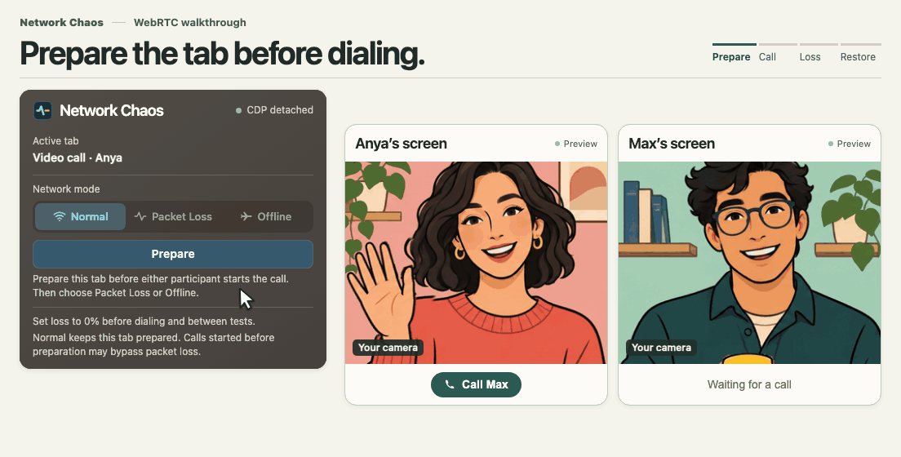

# Network Chaos

A Chrome extension for simulating WebRTC packet loss and offline conditions in a single tab.

## Installation

### Install from a release ZIP

1. Download `network-chaos-<version>-chrome.zip` from **Assets** on the [latest release](https://github.com/anonimizerme/network-chaos/releases/latest).
2. Extract the ZIP to a permanent folder. Chrome loads the extension from this folder, so keep it in place while the extension is installed.
3. Open `chrome://extensions` and turn on **Developer mode** in the upper-right corner.
4. Click **Load unpacked** and select the extracted folder that contains `manifest.json` at its top level. **Network Chaos** will appear in the extensions list.

### Build from source

With Node.js 22.13 or later in the 22.x series, or Node.js 24 or later, run these commands from the project root.

```sh
npm ci
npm run build
```

Open `chrome://extensions`, enable **Developer mode**, click **Load unpacked**, and select the generated `dist/` folder.

### Update an installed copy

Extract the new release ZIP into the same folder, replacing the old files. For a local build, run `npm run build` again. Then click **Reload** (⟳) on the Network Chaos card at `chrome://extensions`. If the popup detects an older background worker, you can click **Reload extension** in the popup instead. Reloading the extension ends its active emulation sessions. To resume testing, reopen Network Chaos on the test tab and click **Prepare tab** again.

## Usage



Open Network Chaos in the tab you want to test. A new page starts in **Normal** with **Packet Loss** and **Offline** disabled. Before either participant places a WebRTC call, click **Prepare tab** and wait for **Prepared**. Normal stays selected, the other modes become available, and the preparation button disappears.

- **Packet Loss** requests 25% WebRTC packet loss on first selection. Adjust the slider from 0% to 100%, optionally enable packet reordering or set the queue length. Returning to Packet Loss on the same prepared tab reuses those settings.
- **Offline** blocks network-dependent requests from the controlled page and sets `navigator.onLine` to `false`. Child frames and existing WebSocket or WebRTC connections may behave differently.
- **Normal** restores unrestricted traffic. After Prepare, Normal keeps the zero-loss rule active so you can turn losses on again during the same call.

Closing and reopening the popup preserves preparation. Reloading the tab or opening a new document returns it to Normal with Prepare available again. If Chrome disconnects the debugger, the popup shows the reason and offers Prepare again. A WebRTC socket created before preparation may continue passing traffic even at 100% loss.

**WebTransport.** The Packet Loss slider applies only to WebRTC. In local HTTP/3 echo tests on Chrome 147 and 156, both existing and newly opened WebTransport sessions exchanged datagrams and bidirectional stream data at 100% loss. They also continued to work in Offline, even while a fresh HTTP request from the same page failed. The Chrome 147 test used the extension, and the Chrome 156 test used its CDP commands directly.

Chromium 159 changed Offline handling for WebTransport. Click **Prepare tab** before opening the session. Switching to **Offline** then closes that session and blocks new connections while Offline is active. This behavior is covered by [Chromium's implementation and tests](https://github.com/chromium/chromium/commit/3feba4b13d1d81becddcb8912d1288d2db0eae64).

## Development

Run `npm run dev` to reload the extension as you edit. Use `npm test` for unit tests, `npm run typecheck` for type checks, and `npm run zip` to create a ZIP in `.output/`.

To run the browser test, build the extension, run `npx playwright install chromium`, then run `npm run test:browser`. For manual testing, see the [diagnostics page](./diagnostics/index.html) and [test scenarios and results](./diagnostics/README.md).

To publish from GitHub, open [Actions → Release Chrome extension](https://github.com/anonimizerme/network-chaos/actions/workflows/release.yml), click **Run workflow**, select the branch, and confirm. After the checks and build pass, the workflow tags the selected commit with the version from `package.json` (for example, `v1.0.0`) and publishes the ZIP in GitHub Releases. Bump the package version before publishing the next release.

You can also trigger the same release by pushing a matching tag.
